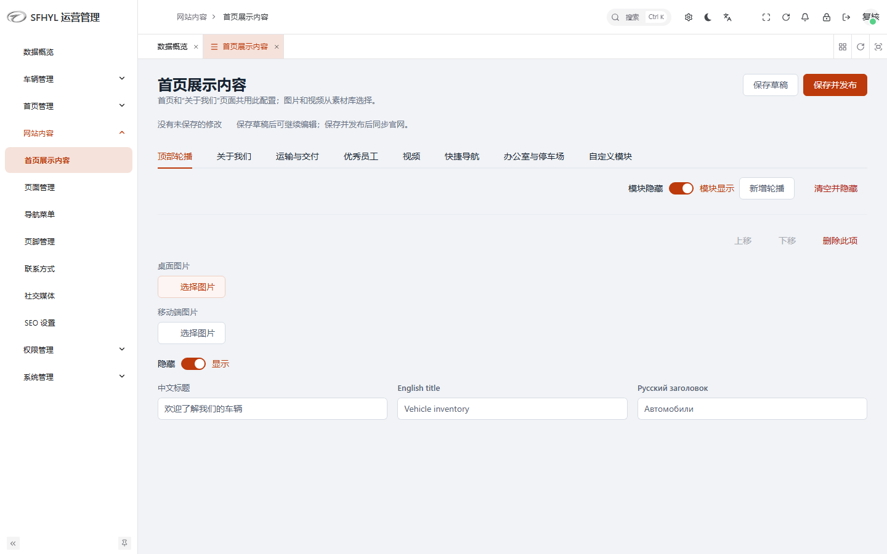
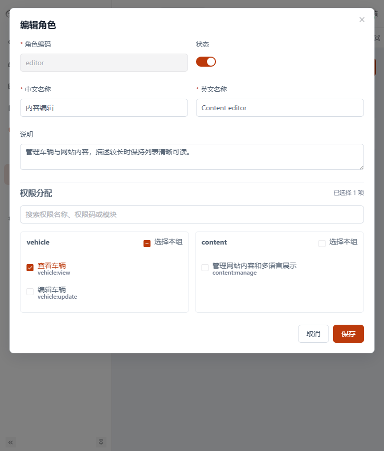
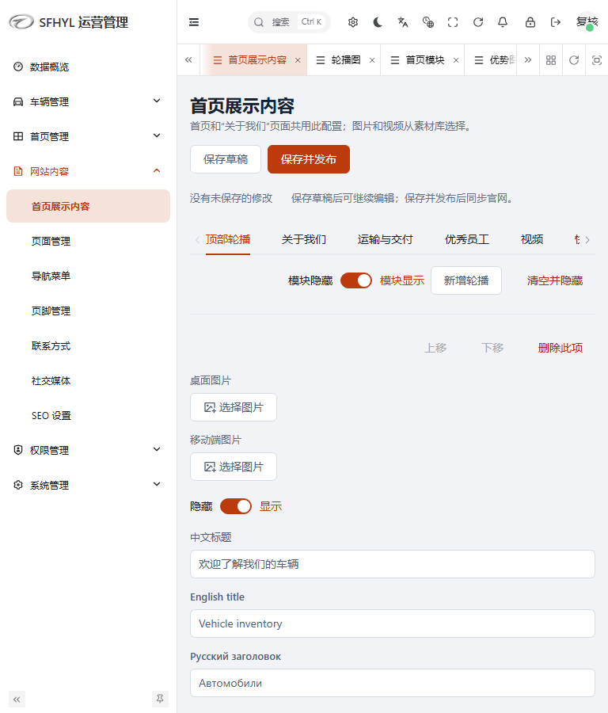

# UI/UX 第 1–6 项补充优化

日期：2026-10-08。本轮沿用首次建立的公共 Token，继续优化当前启用的 React 官网和 Vben 后台，重点补齐内容编辑、权限、日志与系统配置页面。源码已修改，未进行生产部署。

## 1. 进一步检查与问题修复

在上一轮基础上逐页检查发现：多个后台列表读取失败后会显示空表格，邮件和存储页面会在数据尚未读取时显示“未启用”或未接入；权限弹窗缺少搜索和部分选中反馈；多语言输入主要依赖 Placeholder；复杂编辑器和日志详情仍有不规则间距、重复标题和独立颜色。

另外，原 Vben Typecheck 排除了业务页面目录。本轮新增 `apps/web-ele/tsconfig.ui.json`，检查本轮涉及的内容、权限、系统、目录页面及导入的公共代码，并将它接入根目录 `pnpm typecheck`。修正了已有数组索引、路由元数据、字段读取和组件绑定的类型注解，没有更改接口数据结构。

## 2. 设计规范继续统一

仍使用 `shared/ui-tokens.css` 的品牌主色、中性色及状态色、4/8/12/16/24/32/48 间距、4/6/8 圆角与 180ms 交互时长。

- 模块标题使用统一 18px Token；辅助信息和字段 Label 使用 12/13px。
- 普通按钮、图标按钮、Dialog、Drawer、确认框统一边界、Padding、尺寸和焦点反馈。
- 表格文字、Success/Warning/Error Badge 使用语义 Token；日志 JSON 展示采用中性背景并支持长文本断行。
- 官网页脚减弱标题颜色和地址图标的视觉重量，保留导航及联系信息。
- 编辑器的重复条目使用分隔线组织，减少额外卡片边框；主要操作为保存并发布，添加条目使用普通按钮。

## 3. 公共组件

新增公共能力：

| 文件 | 作用 |
| --- | --- |
| `sfhyl/legacy/composables/usePageLoad.ts` | 统一读取过程、错误信息和重试，区分读取失败与成功空数据 |
| `sfhyl/legacy/components/PageLoadState/index.vue` | 公共初次加载骨架与错误重试入口 |
| `sfhyl/legacy/utils/confirm-action.ts` | 保留确认机制，将取消/关闭作为正常结束处理 |
| `sfhyl/legacy/utils/action-feedback.ts` | 保存失败时显示错误，保留编辑内容并结束 Loading |

改进现有公共组件：

- `LocalizedInputs.vue`：每种语言显示 Label，添加输入的可访问名称，在中等屏幕改为单列，支持明确的 Disabled 状态。
- `ModuleSectionHeader.vue`、`HeroTab.vue`、`CustomModulesTab.vue`：统一添加操作权重及只读字段表现。
- 官网 `Header.jsx`：点击导航外部关闭菜单，切换语言后收起菜单，从桌面缩回平板时清理旧展开状态，保留 Escape 焦点恢复。
- `operations.scss`：统一图标按钮、表格文字、状态标签、抽屉、确认框及长文本展示。
- `interface.css`、`RichSiteFooter.jsx`：统一页脚文字、图标及键盘焦点。

## 4. 页面范围

补充逐页检查和修改的后台入口：

| 分类 | 页面 |
| --- | --- |
| 内容 | 首页展示内容、首页轮播图、首页模块、优势图标 |
| 权限 | 管理员、角色权限、权限列表 |
| 日志 | 操作日志、登录记录、系统日志 |
| 配置 | 邮件设置、文件存储、系统信息、API 模型配置 |
| 目录 | 品牌管理对应的车辆目录页面 |

首页模块共用组件同时覆盖推荐车辆、品牌展示、公司简介、首页视频、行动按钮入口；目录共用组件同时覆盖车系、车型、分类、标签。共用分支获得公共修复，但不将其每一种数据和权限组合视为已逐一验收。

官网补充导航和页脚优化，并复跑首页、车辆目录、车辆详情、联系、登录及原 About 入口行为的已有回归。保留当前项目的 About 重定向行为。

## 5. 交互调整

- 读取失败隐藏误导性的空表格或配置状态，并提供原地重试；初次读取提供骨架。
- API 模型配置读取失败时隐藏表单并禁用保存，读取过程中禁用编辑。
- 角色权限支持搜索名称、权限码和模块；过滤不会丢失已选权限，分组复选框显示部分选中状态，全局显示选择数量。
- 管理员及角色表单将现有必填条件显示在字段附近；管理员密码继续使用原有至少 12 位的条件，不新增业务校验规则。
- 内容编辑器显示是否存在未保存修改；只读多语言字段对鼠标和键盘均呈 Disabled 状态，保留原权限条件及未保存离开确认。
- 本轮涉及的角色、管理员、轮播、优势、推荐移除确认，正常取消不产生未处理异常。
- 本轮涉及的保存表单出现请求失败时，保留输入、选中权限和弹窗，显示错误并结束保存状态，便于重试。
- 系统日志级别使用克制的语义标签；日志详情长文本和 JSON 在抽屉内换行。

上述改动仅调整前端显示、交互状态和错误处理。原 API 地址、请求结构、数据库、路由定义、权限判定和成功保存流程保持原样。

## 6. 响应式与验证

扩展浏览器检查使用有内容、长文本和配置数据的模拟接口，在 1440/1280/1024/768px 下验证上述 15 个后台入口，检查页面、角色弹窗与日志抽屉的溢出和可操作性；补充 390px 管理员表单校验。

多语言字段在 1024px 及以下使用单列。权限名称和权限码允许合理断行，避免与复选框互相挤压。Dialog/Drawer/确认框继续遵守公共视口边界；系统信息与长地址允许换行。官网验证菜单关闭、焦点恢复和跨断点状态清理。

| 检查 | 最终结果 |
| --- | --- |
| `pnpm lint` | 通过，清单扩大到本轮业务组件和公共模块 |
| `pnpm typecheck` | 通过，包含新增业务页面专项 Typecheck |
| 本轮后台 SCSS/Vue Stylelint | 通过 |
| `pnpm build` | 通过：官网、Vben 后台、API |
| 官网浏览器测试 | 30 项通过 |
| 当前后台浏览器测试 | 11 项通过 |

复现命令：

```powershell
pnpm lint
pnpm typecheck
pnpm build
pnpm exec playwright test --project=website --project=website-mobile
pnpm exec playwright test --config playwright.ui.config.ts
```

测试在本地拦截接口，不读取或写入真实业务数据库。保存失败测试发送的是被拦截的模拟请求，用于验证表单不会丢失输入。最终日志为 `logs/ui-review/round2-*.log`。官网仍有大 Chunk 的构建提示；真实数据量、上传服务、生产账号权限组合及完整深色主题仍需要部署前验收。

## 最终截图

使用模拟数据。






