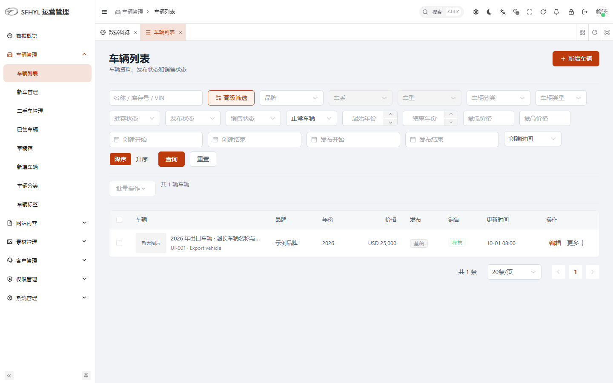
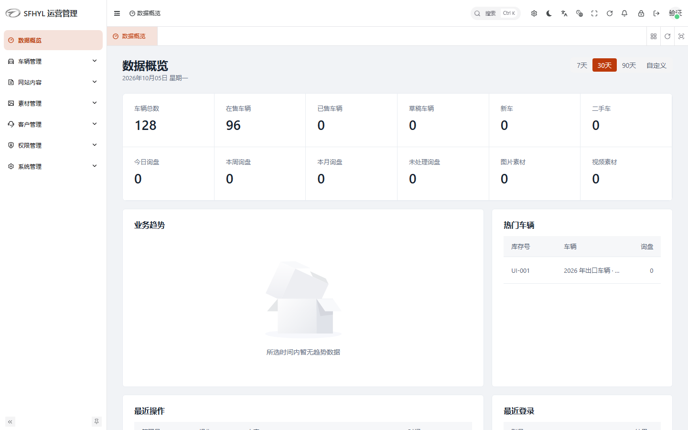
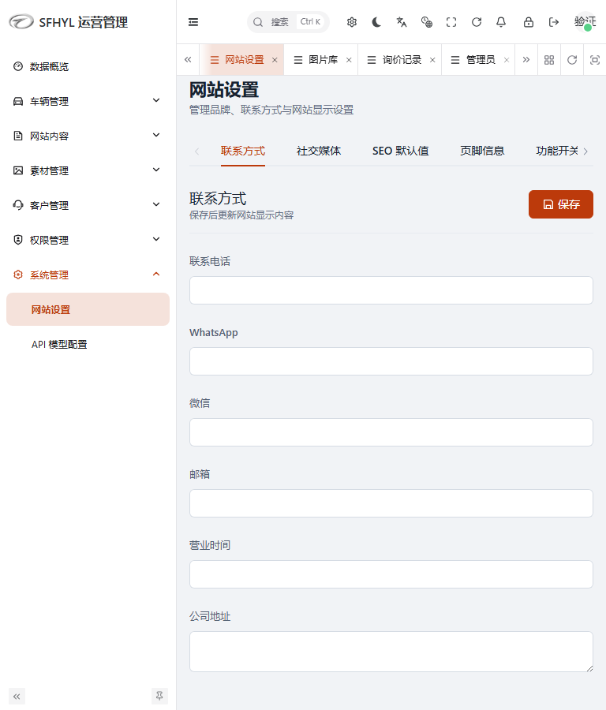
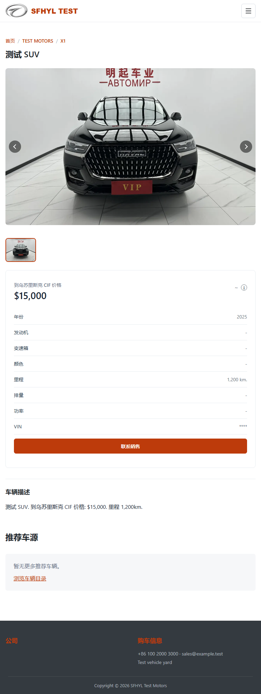

# UI/UX 检查与实施记录

日期：2026-10-05。范围：React 官网及当前启用的 Vben 运营后台。修改已落地到项目源码，未发布到生产环境。

2026-10-08 已继续完成第 1–6 项补充优化，最新范围、校验结果与截图见 [第二轮记录](ui-ux-review-round2.md)。本文保留首次检查记录。

## 1. 架构与发现的问题

官网使用 React 19、React Router 7、Vite 8、原生 CSS 与 Lucide。基础样式位于 `src/styles.css`，路由页面与导航、筛选、询价等公共组件独立组织。官网通过 `/api/v1` 获取内容，后台通过 `/admin` 入口访问。

当前后台使用 `admin-vben/apps/web-ele` 的 Vue/Vben/Element Plus，继承 `sfhyl/legacy` 的业务组件和样式。原 `apps/admin-web` 保留为迁移参考，并仍参与根目录的静态检查。后台框架已有主题、菜单折叠、权限指令、表格、Dialog、Drawer 等能力，因此本次使用现有组件和布局扩展统一样式。

检查发现：

- 官网与后台缺少共享语义 Token；间距、圆角、标题、表单、卡片和按钮的尺度不一致。
- 官网首屏及模块间距偏大，车辆详情有空的布局区域，普通内容使用了较多边框卡片、阴影和装饰。
- 768px 官网导航虽然没有水平溢出，中文菜单仍被挤成异常换行；筛选工具在中等宽度下排列松散。
- 自定义筛选下拉缺少键盘操作、焦点反馈与完整的组合框语义。
- 询价弹窗缺少可靠的焦点管理、关闭后焦点恢复；联系信息校验缺少字段附近的说明与反馈。
- 后台车辆表格操作列过宽，次要操作和主要操作权重接近；批量操作缺少选择数量反馈。
- 高级筛选中的日期组件使用 `v-show`，组件片段根节点导致关闭时仍显示输入控件。
- 后台车辆编辑底部操作条依赖旧侧栏的固定宽度，缩小窗口或折叠菜单时容易错位。
- 设置页的小屏分栏和侧向标签压缩了表单；初次加载失败后仍可编辑默认空值。
- 数据概览缺少明确的初次加载、错误和趋势空状态；图表需要随容器尺寸变化更新。
- 取消删除确认框会抛出未处理的 `cancel` 异常。

## 2. 统一设计规范

公共入口为 `shared/ui-tokens.css`。官网由 `src/styles/interface.css` 集中适配，后台由 `sfhyl/legacy/style/operations.scss` 集中适配。

| 规则 | 实施值 |
| --- | --- |
| 品牌主色 | 橙棕 `#bd3b0b`，Hover `#9d3009`，弱强调 `#fff2eb` |
| 中性色 | 背景、Surface、Border、Divider、正文、次级文字、Muted 独立语义 |
| 状态色 | Success `#18734c`、Warning `#946200`、Error `#b42318` |
| 间距 | 4 / 8 / 12 / 16 / 24 / 32 / 48 |
| 圆角 | 4 / 6 / 8；按钮与输入 6，普通容器与弹窗 8 |
| 常用字号 | Caption 12、Label 13、正文 14、模块 18、页面标题 24 |
| 字体 | Inter、Segoe UI、PingFang SC、Microsoft YaHei、sans-serif；使用可用系统字体回退 |
| 页面容器 | 官网最大 1280px；后台业务区最大 1600px |
| 控件 | 官网主要表单/按钮 44px；后台紧凑控件 36px |
| 表格 | 表头 44px、行最小 56px、Cell 横向 Padding 16px |
| 动效 | 180ms；尊重减少动态效果偏好 |

正文主要采用 400/500 字重，标题与主要行动使用 600。营销首屏保留较大标题，表单、详情、后台使用紧凑层级。阴影集中于浮层，普通层级采用背景、细边框和分隔线。保留品牌图片，去除占位符字符图标和无意义的渐变装饰。

Element Plus 保留 Primary、Default/Outline、Link/Ghost、Danger 等原有按钮类型和 Disabled/Loading 行为，统一尺寸、字重、圆角和图标。车辆列表的次要操作归入 More，展开筛选采用弱强调。已有用户保存的 Vben 外观偏好继续保留，新的会话使用统一默认主题。

## 3. 公共组件与 Layout

- `Header.jsx`：统一导航、Active/Hover、语言状态、跳过导航链接、折叠菜单和 Escape 焦点恢复。
- `SearchPanel.jsx`：键盘可用的 Combobox/Listbox、上下键/Home/End、选择后恢复焦点、点击外部关闭。
- `InquiryForm.jsx`：自动填充、字段说明、就近错误、忙碌状态与成功状态语义。
- 新增 `InquiryDialog.jsx`：原生 Dialog、初始焦点、Tab 循环、Escape、点击遮罩关闭、滚动锁定和触发按钮焦点恢复。
- `CustomModules.jsx`：占位图片使用现有 Lucide 图标。
- Vben Basic/Auth Layout：统一内容区和主题，认证页改用业务标题和说明，移除模板渐变及浮动插画。
- Element Plus 表格、表单、按钮、Dialog、Drawer、Pagination、Badge：集中调整公共样式。
- 素材选择器与素材卡片：统一选中态、Caption、间距和浮层边界。

## 4. 页面修改

官网：首页/车辆目录、车辆详情、关于我们、联系我们、登录、账户页面。公共规范覆盖这些页面；账户增加初次加载骨架和异常重试，车辆详情增加推荐为空的继续浏览入口。

后台：数据概览、车辆列表、车辆新增/编辑、网站设置、图片/视频素材页、登录。公共样式也覆盖询价记录、管理员列表等使用既有业务容器和 Element Plus 的页面。

原 PureAdmin 的八个文件仅修正已有 ESLint/Prettier 格式问题，未改变其业务语义。

## 5. 交互优化

筛选支持键盘及外部点击关闭；导航和询价弹窗支持 Escape 和焦点恢复。询价提交继续使用原有请求内容。账户、数据概览、网站设置区分 Loading、Empty、Error，错误可以重试。设置读取失败时隐藏编辑表单并禁用保存，避免用默认空值覆盖配置。图表仅在容器拥有有效尺寸时初始化，并随容器变化更新；空状态切换为有数据、缩小窗口均有浏览器验证。

车辆表格保留编辑、预览、发布、下架、复制、删除和原有权限条件；次要操作折叠到菜单。批量按钮无选择时禁用并显示选择数量。高级日期筛选使用条件渲染，保留原有模型值。删除保持原确认流程，对正常取消直接结束操作，其他异常继续进入原错误路径。

## 6. 响应式验证

官网六个主要入口与后台七个主要入口在 1440 / 1280 / 1024 / 768px 下进行浏览器检查。检查页面水平溢出、标题可见、筛选展开/关闭、设置标签访问、底部操作条边界，并保存重点截图。

官网中等屏幕使用汉堡菜单、筛选两列、调整页边距；小屏采用单列。后台设置在 1024px 及以下切换顶部标签，900px 及以下使用单列表单；车辆编辑操作条跟随内容区 Sticky，表格在自身容器内滚动，分页允许换行，Dialog/Drawer 限制为可用视口尺寸。另验证 390px 的设置页和素材选择弹窗。

## 7. 业务保护

本次未修改 API 实现、数据库 Schema、迁移、权限模型或路由定义；未删除功能。涉及的应用代码改动仅用于渲染状态、重试触发、筛选控件显示、已有操作入口和正常取消处理。车辆配置解析移除一个随即被覆盖的多余初始化值，以通过检查；解析和提交内容保持一致。

浏览器验证使用模拟接口与固定样本数据，未执行持久化的业务写入。测试确认删除取消没有发出删除请求，菜单仍保留各操作。真实数据库、上传服务与生产权限账号的端到端验收应在部署前补充。

## 8. 检查结果与复现

| 检查 | 结果 |
| --- | --- |
| `pnpm lint` | 通过 |
| `pnpm typecheck` | 通过 |
| `pnpm build` | 通过：官网、当前后台、API |
| 官网浏览器回归 | 29 项通过 |
| 当前 Vben 后台浏览器回归 | 5 项通过；同时断言无页面未处理异常及 ECharts 容器警告 |

根目录 Typecheck 覆盖 API、Vben 和保留的旧后台；官网为 JavaScript，使用构建和浏览器回归验证。根 Lint 按项目现有脚本执行，并扩大当前后台检查清单，覆盖本次修改的业务组件。当前后台修改的 SCSS 另用其 Stylelint 检查。

```powershell
pnpm lint
pnpm typecheck
pnpm build
pnpm exec playwright test --project=website --project=website-mobile
pnpm exec playwright test --config playwright.ui.config.ts
```

后台测试配置通过 `pnpm dev` 和 `pnpm admin:dev` 启动或复用开发服务，测试内拦截接口；不需要真实数据库。官网沿用原浏览器测试的接口样本。最终命令日志位于 `logs/ui-review`。官网构建仍有大型 Chunk 提示；未在 UI 优化范围内调整拆包策略。

## 9. 后续值得继续优化

首页内容编辑器的复杂配置分组、角色/权限矩阵、大量素材的批量管理、邮件/存储配置与日志检索值得单独继续检查。上述页面已获得公共视觉规则，本次没有逐个验证所有业务分支。

还建议用真实大数据量补充表格长文本、分页和权限组合验收，全面复核用户自定义主题及深色模式。当前最小/空样本回归不能代表所有生产数据情况。开发启动日志中的 Vben Form 插槽迁移提示及 Vue 对既有 `const` 表单绑定的编译提示，也应在后续框架迁移整理中处理；本次运行和构建检查通过。

## 复核截图

截图来自模拟数据，不是生产业务记录。








